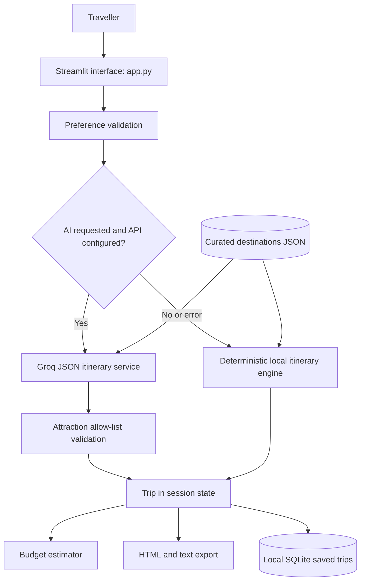

# NammaTrip AI — Karnataka Travel Planner

**A personalized, day-by-day Karnataka trip planner for the Kannada Digital Innovation Hackathon 2026 at The National Institute of Engineering, Mysuru.**

> **Problem statement:** Develop an AI-powered travel planner that creates personalized Karnataka itineraries based on a traveller's interests, available time, budget, and preferred type of experience.

NammaTrip turns those preferences into a practical single-destination itinerary. It works without an API key using a deterministic local planner and curated attraction dataset. When configured, Groq can arrange the same curated stops; it cannot introduce unverified attractions. Budget figures are transparent planning allowances, not live quotes.

## Features

- Preference form for origin, dates, trip length, budget, group size, interests, pace, transport mode, stay and dietary needs.
- Ten curated destinations with attraction descriptions, visit durations, categories and practical notes.
- Local itinerary generation with a clear AI fallback path.
- Optional Groq itinerary organization with JSON mode and attraction allow-list validation.
- Group and per-person budget estimates with category sums, remaining budget and explicit assumptions.
- Change, remove and reorder itinerary activities.
- Save trips locally in SQLite; retrieve them from the sidebar.
- Download printable HTML or a plain text itinerary.
- Contextual in-app assistant for itinerary facts, visit durations and budget questions.
- Responsive Streamlit layout, destination filtering, sample trip inspirations and a persistent estimate disclaimer.

## Hackathon presentation

The seven-slide presentation is available as [NammaTrip AI presentation (PPTX)](output/NammaTrip-AI-Hackathon-Presentation.pptx). It includes a cover followed by the six required sections: problem statement, existing system, solution differences, approach, tech stack and architecture, and conclusion.

## Architecture



Modules:

- `app.py`: Streamlit interface and session interaction.
- `data/destinations.json`: curated destination and attraction records.
- `services/destinations.py`: safe dataset loading.
- `services/itinerary_engine.py`: deterministic fallback itinerary.
- `services/ai_planner.py`: optional Groq integration and response validation.
- `services/budget.py`: deterministic planning ranges.
- `services/storage.py`: local SQLite persistence.
- `utils/validation.py`, `utils/export.py`: preference validation and downloads.
- `tests/`: service and validation tests.
- `docs/`: presentation outline, demo script and submission checklist.

## Run locally

Python 3.11 is recommended. Python 3.11 is configured for Streamlit Community Cloud with `runtime.txt`.

```bash
python -m venv .venv
# Windows PowerShell
.venv\Scripts\Activate.ps1
# macOS/Linux: source .venv/bin/activate
python -m pip install -r requirements.txt
streamlit run app.py
```

The app runs locally without credentials. To enable Groq AI:

1. Create an account at [GroqCloud](https://console.groq.com/) and create an API key at [console.groq.com/keys](https://console.groq.com/keys).
2. Copy `.env.example` to `.env` and add `GROQ_API_KEY` and `GROQ_MODEL`.
3. Install dependencies and restart Streamlit. `.env` is not loaded automatically; in PowerShell, set the variables in the terminal before launching:

   ```powershell
   $env:GROQ_API_KEY="your_key_here"
   $env:GROQ_MODEL="openai/gpt-oss-20b"
   streamlit run app.py
   ```

For Streamlit Community Cloud, add these values under **App settings → Secrets**:

   ```toml
   GROQ_API_KEY = "your_key_here"
   GROQ_MODEL = "openai/gpt-oss-20b"
   ```

Never commit the key. Groq offers a Free tier subject to account and model rate limits. Free quotas and model access can change, so confirm current availability in the Groq console. The configured default is `openai/gpt-oss-20b`.

## Configuration

| Variable | Required | Purpose |
|---|---|---|
| `GROQ_API_KEY` | No | Enables optional Groq itinerary organization; local planner is the fallback. |
| `GROQ_MODEL` | No | Groq model ID; default is `openai/gpt-oss-20b`. |

## Tests

```bash
pytest -q
```

Tests cover budget arithmetic, invalid preferences, absent/corrupt data, fallback generation, AI response validation, absent keys, API failures and SQLite save/retrieve.

## Deploy on Streamlit Community Cloud

1. Create a **public GitHub repository** and push this project, excluding `.env` and the local SQLite database.
2. Sign in to Streamlit Community Cloud and create an app from the repository. Set the main file to `app.py` and select Python 3.11.
3. Add `GROQ_API_KEY` and `GROQ_MODEL` to the app's secrets only if you want Groq AI generation. Deployment remains usable without them.
4. Deploy and verify destination browsing, local itinerary generation, budget totals and downloads from the public URL.
5. SQLite on Community Cloud is local ephemeral storage; saved trips are not durable across restarts or replicas. Use a managed database and authentication before offering persistent accounts publicly.

No repository has been published and no live app URL is claimed by this project workspace. The public GitHub repository, deployed URL, and voice-over recording remain submission actions for the project owner.

## Limitations and future scope

- The first release plans one destination at a time and does not solve multi-city routing or route optimization.
- Attraction information is a curated starting point, not a live feed. Verify operating conditions, entry procedures, weather and access with official/local sources.
- Transport, lodging, food and activity budgets are planning allowances. They are not current provider prices and do not account for every seasonal or accessibility need.
- Travel durations between stops, coordinates, booking integrations, reviews, ratings and live availability are intentionally absent.
- Saved trips are local to the app instance and are not user-authenticated or durable on ephemeral hosting.
- Groq AI output uses only listed attraction names and is validated, but prose organization can still be imperfect. Free-tier limits may change; the local planner is available when API calls fail or limits are reached.
- Next steps: verified source citations and update dates; user accounts with managed storage; multi-city routes using a licensed routing source; Kannada interface and local language support; accessibility and family filters; provider-confirmed prices and booking links.
